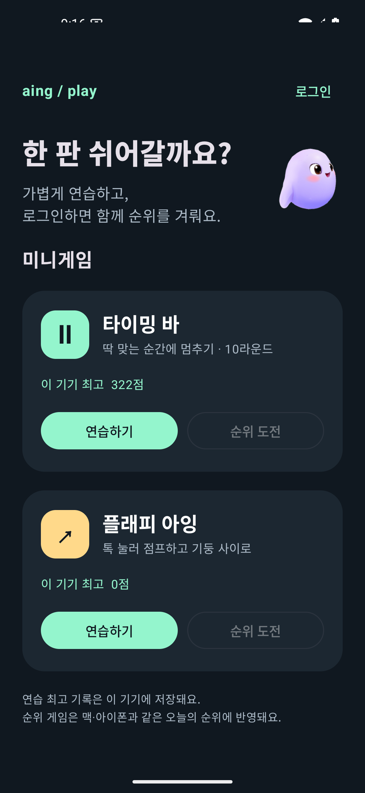
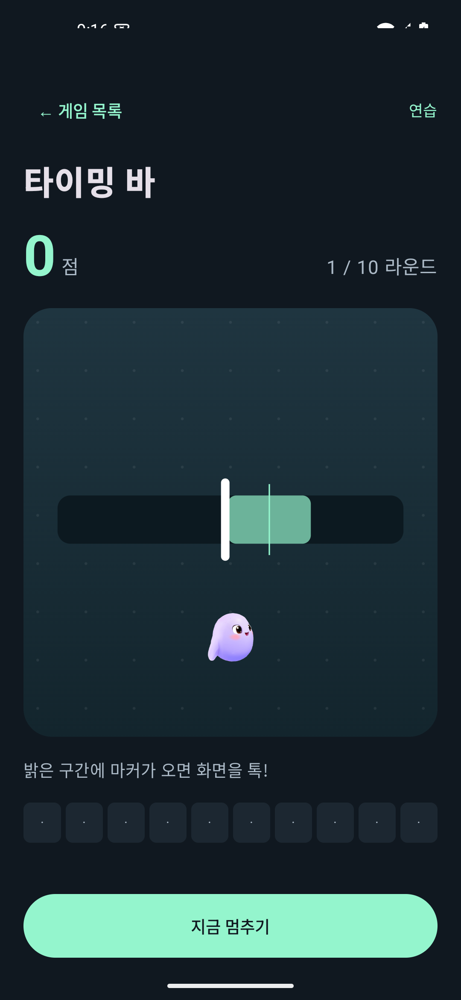

# 아잉 게임 · Android 개발판

Android 8.0 이상에서 타이밍 바와 플래피 아잉을 플레이하는 Kotlin·Jetpack Compose 클라이언트다.
연습은 계정·인터넷 없이 가능하다. 기존 아잉 계정으로 로그인하면 같은 일일 순위표를 조회하고 순위 게임에 참여한다.

 

## 실행

JDK 21, Android SDK Platform 35, Build Tools 35.0.0이 필요하다.
Android Studio에서 이 `android/` 폴더를 프로젝트로 연다. CLI에서는:

```sh
cd android
./gradlew :core:test :app:testDebugUnitTest :app:lintDebug :app:assembleDebug
adb install -r app/build/outputs/apk/debug/app-debug.apk
```

계정 연결을 활성화하려면 커밋되지 않는 `android/local.properties`에 운영자가 제공한 **공개용** anon/publishable key를 넣는다.
URL은 기존 앱의 `SupabaseConfig.projectURL`과 같다. 테스트 서버를 사용하려면 URL도 바꾼다.

```properties
sdk.dir=/your/android/sdk
aing.supabase.url=https://your-project.supabase.co
aing.supabase.anonKey=YOUR_PUBLIC_ANON_OR_PUBLISHABLE_KEY
```

키가 없는 빌드는 연습 전용으로 작동한다. `service_role` 또는 secret key를 앱에 넣으면 안 된다.
비밀번호는 저장하지 않는다. refresh token만 Android Keystore의 AES-GCM 키로 암호화하며, 로그인 저장소는 백업·기기 이전에서 제외한다.

## 게임과 서버 계약

- 타이밍 바: 원본과 같은 10라운드·주기·목표 폭·70~100점/빗나감 0점 규칙.
- 플래피 아잉: 같은 292×302 논리 좌표·중력·점프·충돌·난이도·15점 이후 움직이는 기둥 규칙.
- `core/`는 Android와 분리한 JVM 모듈이다. 같은 SplitMix64 난수를 사용한다.
- 순위 도전은 공개 설정을 확인한 뒤 `minigame_start_round(p_game)` 토큰을 받아 시작한다.
  끝난 판은 `minigame_submit_score(p_game, p_score, p_token)`으로 한 번 제출한다. 테이블 직접 쓰기는 없다.
- `profiles.minigame_public=false` 또는 공개 여부 조회 실패이면 순위 시작·제출을 하지 않는다.
  앱이 배경으로 가거나 중간에 나간 판은 버린다. 화면 회전은 같은 ViewModel의 판을 유지한다.
- 오늘 순위는 `minigame_board(p_game)`를 사용한다. 동점은 기록 시각과 이름으로 정렬한다.
- 401은 refresh token을 갱신해 한 번 재시도한다. 전송 실패는 자동 재시도하지 않고 반영 여부가 불명확함을 표시한다.
  새 판 토큰과 이전 제출이 경합하지 않도록 제출 중에는 다음 순위 판을 열지 않는다.

## 검증

```sh
./gradlew :core:test :app:testDebugUnitTest :app:lintDebug :app:assembleDebug
# 부팅한 Android 에뮬레이터 또는 USB 디버깅 기기에서 실제 입력·화면 전환 검사
./gradlew :app:connectedDebugAndroidTest
# macOS + 서로 맞는 Swift/SDK에서 원본 실행 결과를 다시 생성
python3 scripts/generate-swift-fixture.py
```

`core/src/test/resources/swift-trace.tsv`는 기존 Swift 게임을 직접 실행해 만든 480개 상태다.
Kotlin 테스트는 고정 시드·프레임별 점수·위치·속도·기둥·게임 상태를 대조한다.
플래피 궤적은 30점까지 포함해 움직이는 기둥도 통과한다.
API·세션 테스트는 MockWebServer를 사용하며 운영 서버에 테스트 계정이나 점수를 만들지 않는다.

실제 계정으로 로그인한 뒤 운영 순위표에 점수가 반영되는 흐름과 실기기 성능은 별도 확인이 필요하다.
게임 규칙·서버 호출은 구현돼 있지만, 이 개발판에서 테트리스·오목·체스·근무 타이머·푸시는 제공하지 않는다.

2026-10-27 로컬 검증: 단위 테스트 19개, Android 15 에뮬레이터 OS 입력 테스트 3개, debug APK 빌드·lint 통과.
OS 입력 검사는 타이밍 바 10라운드 완료·재시작, 플래피 실행·뒤로 가기, 백그라운드 전환 시 판 폐기를 포함한다.

## 구조

| 위치 | 역할 |
|---|---|
| `core/` | 게임 규칙·난수·판 토큰 생명주기 |
| `app/.../data/` | Supabase HTTP·세션 갱신·Keystore 저장소 |
| `app/.../GamesViewModel.kt` | 게임 시작·중단·제출·조회 상태 |
| `app/.../MainActivity.kt` | 게임 목록·로그인·게임 화면·순위 |
| `app/src/androidTest/` | OS 터치 입력을 사용한 연습·재시작·백그라운드 테스트 |

macOS·iOS 소스와 운영 서버에는 변경을 가하지 않는다.
